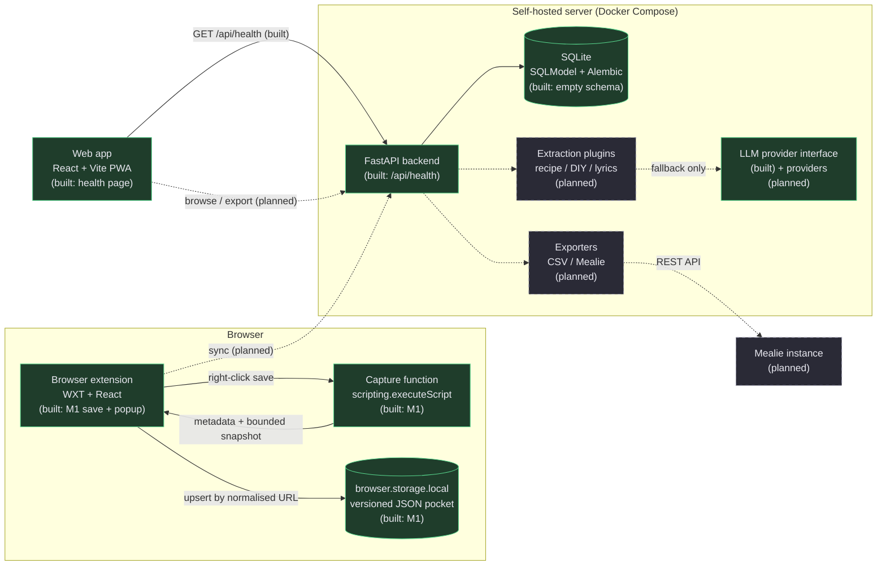
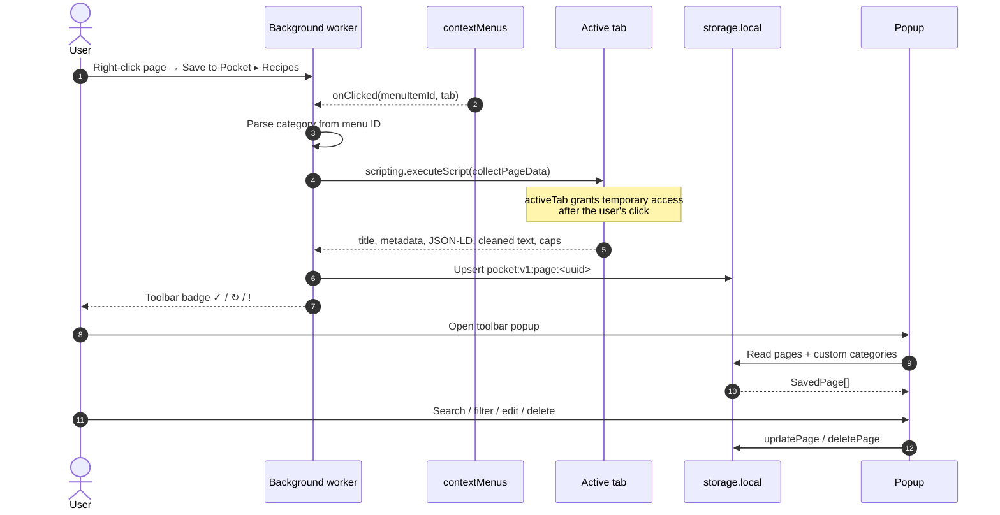
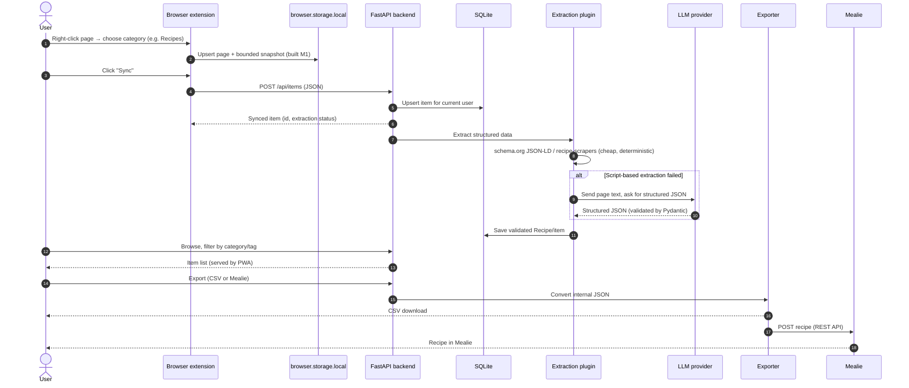

# Architecture

> Status: **M1 local-first saving is implemented** in the extension. Sync, backend authentication,
> extraction and export are still planned. Solid boxes in the diagrams exist and run; dashed boxes
> are planned. This document is updated whenever components or data flows change.

Project Pocket has four cooperating parts:

1. **Browser extension** (WXT + React, Chrome + Firefox): local-first saving, works offline.
2. **Web app** (React + Vite PWA): browse, filter and export the synced pocket.
3. **Backend** (FastAPI + SQLModel + SQLite): source of truth for synced data and the API contract.
4. **Extraction pipeline** (script-based first, LLM fallback): turns saved pages into structured
   items (recipes first) and feeds exporters such as Mealie.

## Component diagram



Reading the diagram: the extension is useful without the server (local-first). Sync is an explicit
action. The backend never scrapes on behalf of the extension without being asked; extraction happens
when the user syncs or explicitly requests it.

## Extension M1 flow (built)



The capture function is injected on demand. There is no persistent content script: the extension
does not read pages until the user asks it to save one.

### Extension modules

| File                             | Responsibility                                                              |
| -------------------------------- | --------------------------------------------------------------------------- |
| `entrypoints/background.ts`      | Register menu/storage listeners, rebuild menu, dispatch menu clicks         |
| `lib/context-menu.ts`            | Menu IDs, category parsing, parent/child menu construction                  |
| `lib/capture.ts`                 | Self-contained page collector, metadata/JSON-LD/text extraction, limits     |
| `lib/storage.ts`                 | Versioned CRUD, URL normalisation, duplicate upsert, categories, validation |
| `lib/save-flow.ts`               | Capture → save → badge workflow, testable through dependency injection      |
| `entrypoints/popup/App.tsx`      | Load pages, search/filter, mutations, custom category form                  |
| `entrypoints/popup/PageCard.tsx` | One page card: open, recategorise, edit tags/note, delete                   |

### Permissions

| Permission     | Why                                                      |
| -------------- | -------------------------------------------------------- |
| `storage`      | save and read the local pocket                           |
| `contextMenus` | build "Save to Pocket ▸ category"                        |
| `activeTab`    | temporary access to the page the user chose to save      |
| `scripting`    | inject the capture function after the context-menu click |

No host permissions, no `tabs`, no notifications. Firefox and Chrome both support these APIs. The
extension never uses `chrome.*` directly; WXT exposes the cross-browser `browser.*` object.

## Local storage format (M1)

`browser.storage.local` holds one JSON record per key:

```text
pocket:v1:page:<uuid>       → SavedPage
pocket:v1:category:<uuid>   → CategoryDefinition (custom categories only)
```

Built-in categories (`recipes`, `diy`, `lyrics`, `other`) are part of the shared code. Custom IDs use
`custom:<uuid>`. The `v1` prefix allows a future migration without guessing which records are old.

A `SavedPage` contains:

| Field                                 | Meaning                                                           |
| ------------------------------------- | ----------------------------------------------------------------- |
| `id`, `url`, `title`                  | Identity and basic page metadata; `url` has no fragment           |
| `favicon`, `siteName`                 | Optional display metadata                                         |
| `description`, `canonicalUrl`, `lang` | Optional capture metadata used by M3                              |
| `category`                            | Built-in or `custom:<uuid>` ID                                    |
| `tags[]`, `note`                      | User-owned data, preserved across repeated saves                  |
| `savedAt`, `updatedAt`                | ISO-8601 UTC strings                                              |
| `snapshot`                            | Parsed JSON-LD + cleaned text + `capturedAt` + `truncated`        |
| `sync`                                | `local`, `pending`, `synced` or `error` (only `local` used in M1) |

Snapshots are bounded instead of storing full HTML:

- visible text: 40,000 characters;
- JSON-LD: 80,000 characters total;
- whole page record: 200,000 bytes.

Repeated saves are an **upsert by normalised URL** (fragment removed, query kept). The page `id`,
`savedAt`, tags and note stay; category, title, metadata and snapshot refresh; `updatedAt` changes.
See [ADR 0002](decisions/0002-local-first-storage.md) for the reasoning and rejected alternatives.

## Planned main flow (M2+)

M1 covers the first two steps below. Sync, extraction, browsing and export are planned.



## Data model

The internal format stays JSON. Recipes follow [schema.org/Recipe] as closely as practical, so
script-based extraction and later LLM output can be validated against one model. M1 formalised the
local `SavedPage` in `packages/shared`; the backend's synced model and structured recipe are still
planned for M2/M3.

| Field                               | Meaning                                                                |
| ----------------------------------- | ---------------------------------------------------------------------- |
| `id`, `url`, `title`, `description` | Identity and basic page metadata                                       |
| `category`                          | `recipes`, `diy`, `lyrics`, `other` or `custom:<uuid>`                 |
| `tags[]`                            | Free-form labels, used for filtering                                   |
| `note`                              | User's own note                                                        |
| `savedAt`, `updatedAt`              | Timestamps (UTC ISO strings)                                           |
| `snapshot`                          | Bounded JSON-LD + cleaned text captured from the page                  |
| `recipe`                            | Optional structured recipe (ingredients, instructions, servings, time) |

CSV is an **export format only**, never the storage format.

## API

The backend owns the contract. FastAPI generates OpenAPI docs automatically at `/docs`.

| Endpoint                             | Status  | Purpose                                    |
| ------------------------------------ | ------- | ------------------------------------------ |
| `GET /api/health`                    | built   | Liveness + version, used by Docker/web app |
| `POST /api/items`                    | planned | Sync a saved item                          |
| `GET /api/items`                     | planned | List/filter the current user's items       |
| `POST /api/items/{id}/extract`       | planned | Run extraction explicitly                  |
| `GET /api/items/export.csv`          | planned | CSV export                                 |
| `POST /api/items/{id}/export/mealie` | planned | Push a recipe to Mealie                    |

## Key design decisions

- **Local-first extension.** Saving a page must never depend on a server being reachable. Sync is
  separate and retryable.
- **Versioned per-record local storage.** One key per page avoids rewriting the whole pocket and
  makes corruption local to one record. Details in ADR 0002.
- **Upsert by normalised URL.** Repeated saves update instead of creating silent duplicates while
  preserving user tags/notes.
- **Bounded snapshots.** Parsed JSON-LD + cleaned text gives M3 useful input without storing full
  HTML or risking the storage quota.
- **Script-based extraction before LLM.** Deterministic parsers are cheap, testable and private;
  the LLM is only a fallback behind a provider interface (`backend/app/llm/base.py`). Tests mock it,
  never call a real API.
- **One internal JSON model, many exporters.** Mealie/CSV/PDF are adapters, so adding an export
  target never changes storage.
- **Backend as the source of truth for synced data.** The web app and extension talk to it over a
  documented REST API; they do not share a database.
- **Same-origin API calls in production.** nginx proxies `/api` to FastAPI so the PWA needs no CORS
  and no hard-coded backend URL. CORS remains available for the extension.
- **Reproducible toolchain in Docker.** Node/pnpm/Python/uv live in `docker/tools`, so no local
  toolchain drift between the two team members and CI.

[schema.org/Recipe]: https://schema.org/Recipe
