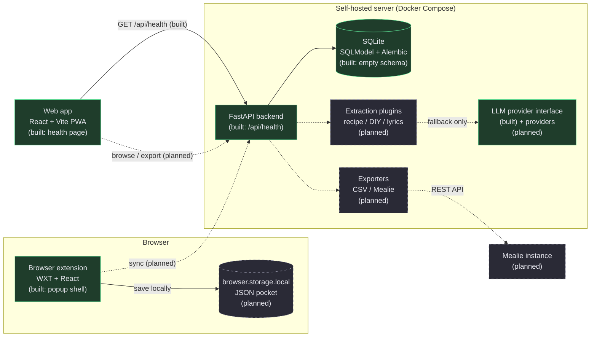
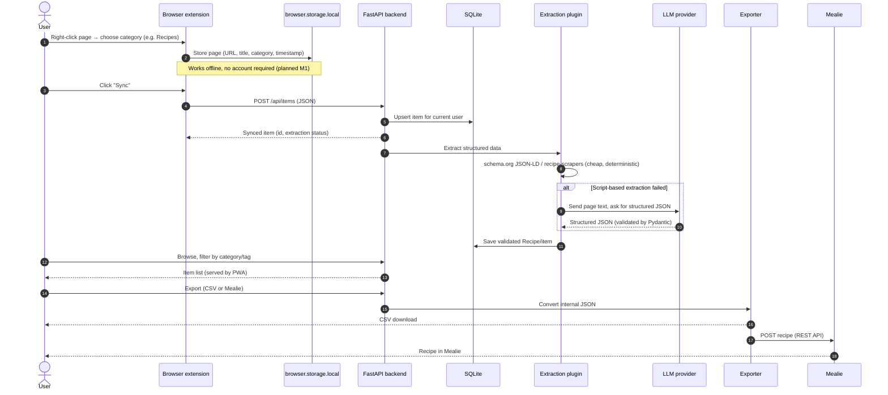

# Architecture

> Status: **M0 scaffold**. Solid boxes exist and run; dashed boxes are planned. This document is
> updated whenever components or data flows change.

Project Pocket has four cooperating parts:

1. **Browser extension** (WXT + React, Chrome + Firefox): local-first saving, works offline.
2. **Web app** (React + Vite PWA): browse, filter and export the synced pocket.
3. **Backend** (FastAPI + SQLModel + SQLite): source of truth for synced data and the API contract.
4. **Extraction pipeline** (script-based first, LLM fallback): turns saved pages into structured
   items (recipes first) and feeds exporters such as Mealie.

## Component diagram

Reading the diagram: the extension is useful without the server (local-first). Sync is an explicit
action. The backend never scrapes on behalf of the extension without being asked; extraction happens
when the user syncs or explicitly requests it.

## Planned main flow

This is the flow we build towards; nothing below except saving the backend URL/health check exists
yet.

## Data model (planned)

The internal format stays JSON. Recipes follow [schema.org/Recipe] as closely as practical, so
script-based extraction and later LLM output can be validated against one model. A first sketch
(from the old prototype, to be formalised in M1/M3):

| Field                               | Meaning                                                                |
| ----------------------------------- | ---------------------------------------------------------------------- |
| `id`, `url`, `title`, `description` | Identity and basic page metadata                                       |
| `category`                          | `recipes`, `diy`, `lyrics` (see `packages/shared`)                     |
| `tags[]`                            | Free-form labels, used for filtering                                   |
| `notes`                             | User's own note                                                        |
| `created_at`, `updated_at`          | Timestamps (UTC)                                                       |
| `recipe`                            | Optional structured recipe (ingredients, instructions, servings, time) |

CSV is an **export format only**, never the storage format.

## API

The backend owns the contract. FastAPI generates OpenAPI docs automatically at `/docs`.

| Endpoint                             | Status  | Purpose                                    |
| ------------------------------------ | ------- | ------------------------------------------ |
| `GET /api/health`                    | built   | Liveness + version, used by Docker/web app |
| `POST /api/items`                    | planned | Sync a saved item                          |
| `GET /api/items`                     | planned | List/filter the current user's items       |
| `POST /api/items/{id}/extract`       | planned | Run extraction explicitly                  |
| `GET /api/items/export.csv`          | planned | CSV export                                 |
| `POST /api/items/{id}/export/mealie` | planned | Push a recipe to Mealie                    |

## Key design decisions

- **Local-first extension.** Saving a page must never depend on a server being reachable. Sync is
  separate and retryable.
- **Script-based extraction before LLM.** Deterministic parsers are cheap, testable and private;
  the LLM is only a fallback behind a provider interface (`backend/app/llm/base.py`). Tests mock it,
  never call a real API.
- **One internal JSON model, many exporters.** Mealie/CSV/PDF are adapters, so adding an export
  target never changes storage.
- **Backend as the source of truth for synced data.** The web app and extension talk to it over a
  documented REST API; they do not share a database.
- **Same-origin API calls in production.** nginx proxies `/api` to FastAPI so the PWA needs no CORS
  and no hard-coded backend URL. CORS remains available for the extension.
- **Reproducible toolchain in Docker.** Node/pnpm/Python/uv live in `docker/tools`, so no local
  toolchain drift between the two team members and CI.

[schema.org/Recipe]: https://schema.org/Recipe
