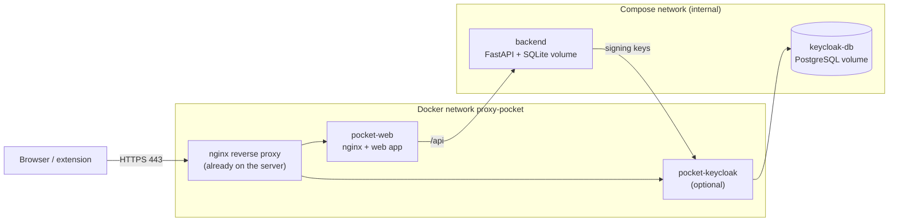

# Deployment on a server

How to run Project Pocket on a self-hosted server where an nginx reverse proxy already serves other
apps over HTTPS. Keycloak is optional: without it, Pocket uses its own local accounts.

The examples use `pocket.example.org` and `auth.example.org`. Replace them with your host names.

> **Status (2026-11-14):** the complete server setup ran in a local throwaway stack: no published
> ports, Keycloak in production mode with PostgreSQL, the correct issuer behind forwarded headers,
> and the realm import with its variable. **Not run yet:** a real server with a real reverse proxy
> and certificate, and a browser login through it. Update this note after the first deployment.

## What runs where



No container publishes a port. The proxy is the only way in, and the backend is reachable only
through the web container.

## Requirements

- Docker Engine with Compose 2.24 or newer (`docker compose version`); older versions do not know
  the `!reset` tag used in the server files.
- A reverse proxy with a certificate that covers both host names, e.g. a wildcard certificate.
- DNS records for both host names that point to the server.

## 1. Get the code and configure it

```bash
git clone <repository-url> project-pocket
cd project-pocket
cp docker/server/server.env.example .env
```

Edit `.env`:

1. Replace `pocket.example.org` and `auth.example.org` everywhere.
2. Set the two secrets. Generate each with `openssl rand -base64 24`.

**Secrets:** `KEYCLOAK_ADMIN_PASSWORD` (login to the Keycloak admin console) and
`KEYCLOAK_DB_PASSWORD` (Keycloak's database) exist only in `.env` on the server. `.env` is
git-ignored; never commit it. Compose refuses to start Keycloak while either is empty.

To run **without Keycloak**, remove `docker-compose.server-keycloak.yml` from `COMPOSE_FILE`, clear
`COMPOSE_PROFILES` and the three `POCKET_OIDC_*` values, and skip the Keycloak parts below.

## 2. Connect the reverse proxy

```bash
# The network the proxy and Pocket share.
docker network create proxy-pocket

# Attach the running proxy container (here it is called "nginx").
docker network connect proxy-pocket nginx
```

`docker network connect` is lost when the proxy container is recreated. Also add `proxy-pocket` as
an external network to the proxy's own Compose file, the same way its other app networks are listed.

Install the server blocks and replace the example host names:

```bash
sed -e 's/pocket\.example\.org/pocket.YOUR-DOMAIN/' -e 's/auth\.example\.org/auth.YOUR-DOMAIN/' \
  docker/server/nginx/pocket.conf.example > /path/to/nginx/conf.d/pocket.conf
```

The template expects the snippets `headers.conf`, `robots-deny.conf`, `proxy.conf` and
`lan-only.conf` under `/etc/nginx/snippets/` and a proxy that listens on 8443 inside its container.
Adjust it if your proxy differs. Do not reload nginx yet: the containers it points to do not exist.

## 3. Start Pocket

```bash
docker compose up -d --build
docker compose ps
```

`COMPOSE_FILE` and `COMPOSE_PROFILES` in `.env` make the plain command use the server files. Wait
until `backend` is healthy; Keycloak needs about a minute for its first start. Then check and reload
the proxy:

```bash
docker exec nginx nginx -t && docker exec nginx nginx -s reload
```

## 4. Check it

```bash
curl -s https://pocket.example.org/api/health
curl -s https://pocket.example.org/api/auth/config
curl -s https://auth.example.org/realms/pocket/.well-known/openid-configuration | head -c 200
```

Expected: `{"status":"ok",...}`, then the issuer and client ID, then a JSON document whose `issuer`
is `https://auth.example.org/realms/pocket`. The issuer must equal `POCKET_OIDC_ISSUER` exactly.

## 5. Create users in Keycloak

The server realm has no users and no self-registration.

1. From the local network, open `https://auth.example.org/admin/` and log in as `admin` with
   `KEYCLOAK_ADMIN_PASSWORD`.
2. Switch to the realm **pocket**, open **Users** and add each user with a password.
3. In the realm **master**, create a personal admin account and delete the bootstrap `admin` user.

In **Clients → project-pocket**, the valid redirect URI must be `https://pocket.example.org/*`.
Keycloak fills it from `POCKET_PUBLIC_URL` when it imports the realm on its first start. If the
address is wrong, correct it there by hand; changing `.env` later does not update an existing realm.

## Update

```bash
git pull
docker compose up -d --build
```

Database migrations run automatically when the backend starts. The realm file is only imported while
the realm does not exist; later changes to it are made in the admin console.

## Backup

Everything worth keeping is in two Docker volumes:

| Volume                            | Content                                 |
| --------------------------------- | --------------------------------------- |
| `project-pocket_pocket-data`      | SQLite database: accounts, synced pages |
| `project-pocket_keycloak-db-data` | Keycloak users and settings             |

`docker compose down` keeps them. `docker compose down -v` deletes them.

## Limits to know

- The test realm in `docker/keycloak/` (user `demo`, public password) is for local development only.
  The server files replace it; never expose it to a network.
- Uploads are limited to 1 MB by the proxy template and to 256 KB per page by the backend.
- SQLite is fine for a small group. Many simultaneous writers would need PostgreSQL for Pocket too.
